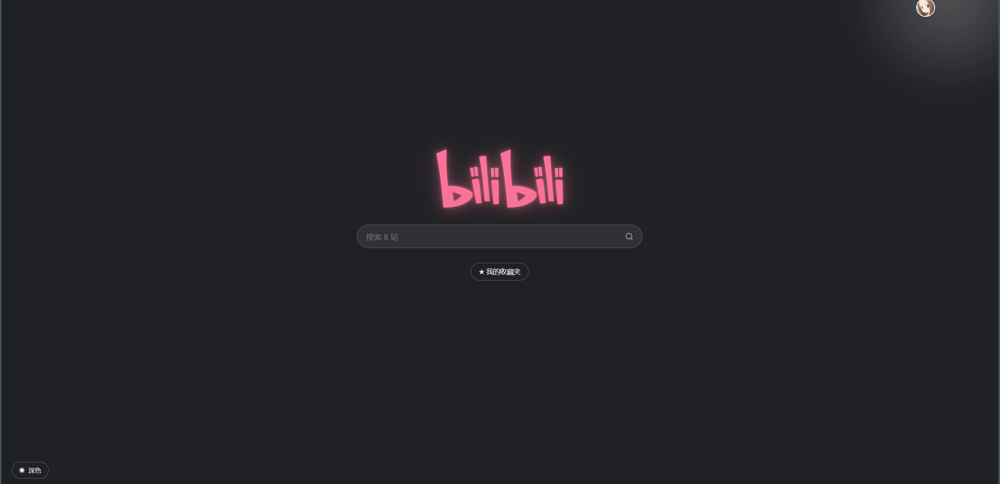
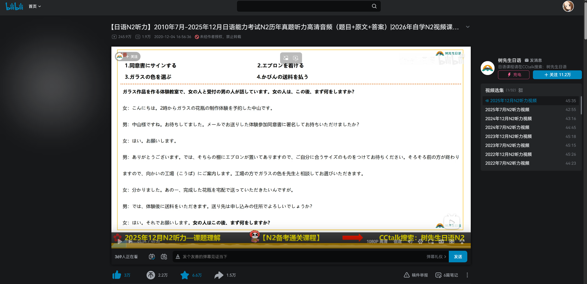

# B站右栏清理 · BiliRightClean

给 B 站用的 Edge / Chrome 扩展（Manifest V3）。

**一句话：把首页变成 Google 那样只剩搜索框，把顶栏砍到只剩「首页 + 头像」，把视频页右栏砍到只剩「UP 主卡 + 视频选集」。**

纯前端注入：不请求任何服务器、不读账号信息、不改你的设置。

## 截图

| 首页（深色 · Google 式） | 视频页（右栏只剩 UP 主卡 + 选集） |
| --- | --- |
|  |  |

## 装到 Edge

1. 地址栏打开 `edge://extensions/`
2. 左下角打开 **开发人员模式**
3. 点 **加载解压缩的扩展**，选中本文件夹
4. 打开 B 站任意页面

> 以后更新：把新文件覆盖到同一目录 → 点扩展卡片上的**重新加载**（圆形箭头）→ 刷新页面。不用删掉重装。
> 目录别改名/移动，Edge 记的是这个路径。

## 功能

### 顶栏
- 左上只留 `bilibili` 图标 + 「首页」，番剧/直播/游戏中心/会员购/漫画/赛事/BLG/发布会/下载客户端全删
- 右上只留头像，大会员/消息/动态/收藏/历史/创作中心/投稿按钮全删；首页那排频道条也删
- 头像右移留出间距，个人中心弹层不会再冲出屏幕

### 首页（Google 式）
- 整页只剩：居中 bilibili 字标（官方 SVG）+ 搜索框 + 右上头像
- 横幅、频道条、轮播、所有视频卡片、浮动按钮全删
- 搜索框下「★ 我的收藏夹」直达收藏夹
- 点搜索框才弹搜索历史（词块样式，可清空；本地记录，最多 8 条）
- 鼠标跟随光晕（全站生效，可调颜色/强度，0 = 关闭）
- 左下角按钮切换深/浅色，带 0.45s 过渡；字标带呼吸光晕

### 视频页
- 右栏只留 **UP 主卡（名字/发消息/充电/关注）+ 视频选集**，弹幕列表、推荐、广告全删
- 视频保持居中；窗口变窄时右栏整体等比缩小，余量不足 200px 自动隐藏，绝不压画面
- 「播放器放大铺满整行」可把播放器放大到窗口能容下的最大值（16:9 不裁切）

### 搜索框（全站）
- 删掉热搜榜、推荐词、输入框里轮播的灰字提示
- **搜索历史保留**

### 个人空间 / 收藏夹
- 打开收藏夹只留「左侧目录 + 视频网格」，个人主页那层（横幅/大头像/导航条/收藏夹标题卡）全删

## 开关（点工具栏图标）

| 开关 | 默认 | 说明 |
| --- | --- | --- |
| 极简顶栏 | 开 | 只留首页 + 头像 |
| 首页只留搜索框 | 开 | Google 式首页 |
| 字标光晕颜色 | 粉色 | 首页字标发光色 |
| 鼠标光晕颜色 | 跟随主题 | 深色=白、浅色=黑；右侧「默认」一键恢复 |
| 鼠标光晕强度 | 28% | 0 = 关闭 |
| 收藏夹页瘦身 | 开 | 只留目录 + 视频 |
| 右栏只留 UP 主卡 | 开 | 保留 UP 卡与选集 |
| 删掉「推荐 / 接下来播放」 | 开 | |
| 删掉页面广告 | 开 | |
| 播放器放大铺满整行 | 关 | 会隐藏右栏卡片 |

